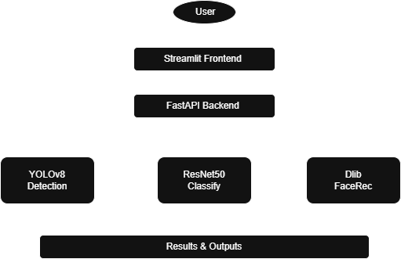
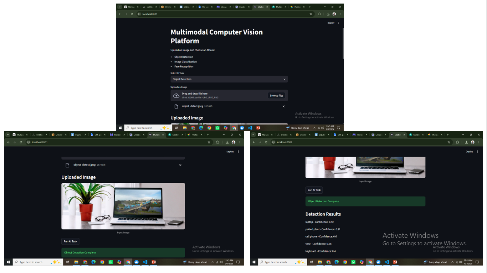
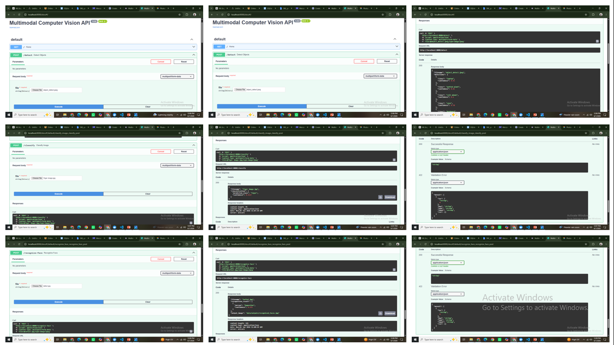
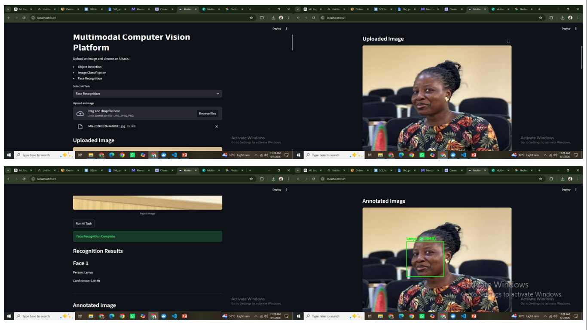

# Multimodal Computer Vision Platform

## Overview

The Multimodal Computer Vision Platform is an end-to-end AI application that integrates multiple computer vision capabilities into a single platform. The system provides:

* Object Detection using YOLOv8
* Image Classification using ResNet50
* Face Recognition using Dlib and Face Recognition
* REST API services with FastAPI
* Interactive user interface with Streamlit
* Containerized deployment using Docker

The platform demonstrates practical applications of deep learning and computer vision by allowing users to upload images and perform multiple AI-powered visual analysis tasks.

---

## Features

### Object Detection

* Detects multiple objects within an image
* Generates annotated output images
* Returns detected classes and confidence scores
* Powered by YOLOv8

### Image Classification

* Classifies uploaded images into predefined categories
* Uses a pretrained ResNet50 model
* Returns predicted class labels and confidence scores

### Face Recognition

* Detects and recognizes faces in uploaded images
* Compares detected faces against known face encodings
* Returns recognized identities and confidence scores
* Generates annotated output images

---

## System Architecture

```text
User
  │
  ▼
Streamlit Frontend
  │
  ▼
FastAPI Backend
  │
  ├── YOLOv8 Object Detection
  ├── ResNet50 Image Classification
  └── Dlib Face Recognition
  │
  ▼
Results & Output Images
```

---

## Technology Stack

### Backend

* Python
* FastAPI
* Uvicorn

### Frontend

* Streamlit

### Machine Learning & Computer Vision

* PyTorch
* TorchVision
* YOLOv8 (Ultralytics)
* OpenCV
* Dlib
* Face Recognition

### Deployment

* Docker

---

## Project Structure

```text
multimodal-computer-vision-platform/
│
├── app/
│   ├── api/
│   ├── classification/
│   ├── detection/
│   └── face_recognition/
│
├── frontend/
│   └── app.py
│
├── data/
│   ├── uploads/
│   └── outputs/
│
├── Dockerfile
├── requirements.txt
├── preload_model.py
└── README.md
```

---

## Installation

### Clone Repository

```bash
git clone https://github.com/Esostar/multimodal-computer-vision-platform.git
cd multimodal-computer-vision-platform
```

### Create Virtual Environment

```bash
python -m venv venv
```

Activate:

Windows:

```bash
venv\Scripts\activate
```

Linux/Mac:

```bash
source venv/bin/activate
```

### Install Dependencies

```bash
pip install -r requirements.txt
```

---

## Running Locally

### Start FastAPI Backend

```bash
uvicorn app.api.main:app --reload
```

Backend URL:

```text
http://localhost:8000
```

### Start Streamlit Frontend

```bash
streamlit run frontend/app.py
```

Frontend URL:

```text
http://localhost:8501
```

---

## Docker Deployment

### Build Image

```bash
docker build -t multimodal-ai-platform .
```

### Run Container

```bash
docker run -p 8000:8000 -p 8501:8501 multimodal-ai-platform
```

### Access Application

Frontend:

```text
http://localhost:8501
```

Backend:

```text
http://localhost:8000
```

---

## API Endpoints

### Object Detection

```http
POST /detect
```

### Image Classification

```http
POST /classify
```

### Face Recognition

```http
POST /recognize-face
```

---

## Future Enhancements

* Real-time webcam inference
* Video object detection and tracking
* OCR and document understanding
* Face enrollment through UI
* Model performance monitoring
* Cloud deployment on AWS, Azure, or GCP
* CI/CD pipeline integration

---

## System Architecture



## Application Screenshots

### Object Detection


### Image Classification


### Face Recognition


---

## Author

**Augustine Ajali Esosa**

Data Analystics | Data Scientist | Machine Learning Engineer | AI Engineer

GitHub:
https://github.com/Esostar
